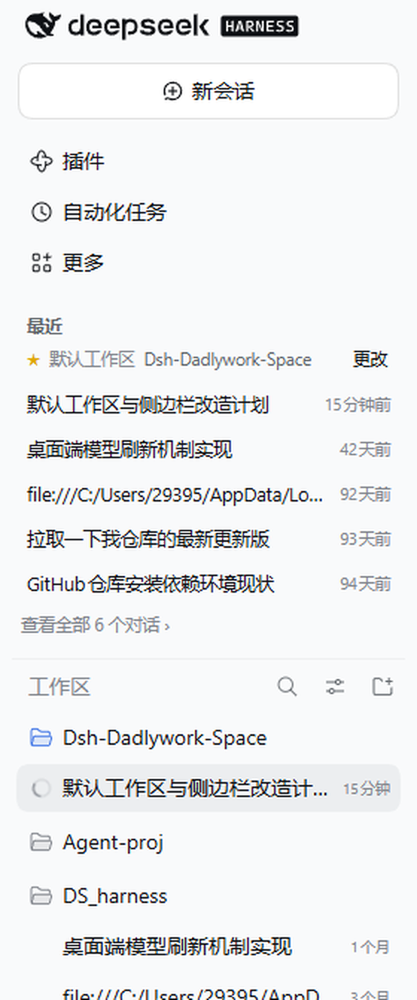

# DSH Daily Workspace

给 [DeepSeek Harness](https://github.com/deepseek-ai) 一个「日常默认工作区」：新对话默认落在你选的文件夹，侧栏顶部显示最近对话；已设为默认的工作区不再在下方分组里重复出现。



> 截图里默认工作区是 `Dsh-Dadlywork-Space`，上方「最近」显示跨工作区的最近对话，下方只列其他工作区。

## 功能

- **任意文件夹作为默认工作区**：点「选择文件夹」会打开系统原生的目录选择器，范围是整个硬盘，且只能选文件夹。选中的路径如果还不是工作区，会自动注册为工作区，不需要先手动添加。
- **新会话默认落点**：点顶部「新会话」或侧栏新会话按钮时，如果没有显式指定工作区，会优先使用默认工作区；显式选择的工作区永远优先，不会被改写。
- **最近对话**：在「工作区」列表上方显示最近 5 个对话（跨工作区、按更新时间倒序，排除空白会话和子代理会话），点击直接打开；「查看全部 N 个对话」打开完整列表。
- **未设置引导**：还没设置默认工作区时，同一位置显示引导卡片和「选择文件夹」按钮。
- **不重复显示**：已设为默认工作区的工作区会从下方「工作区」分组中隐藏，避免和上方「最近」重复；它的历史对话仍可从「查看全部」进入。
- **失效自动清理**：默认工作区被删除后，下次读取会清空指针并回到未设置状态。

## 安装

本插件是一个 DSH bundle。把仓库放到本地后，用 DSH 的插件管理器安装，`target` 传本目录的绝对路径：

```text
plugin_manager install_bundle { "target": "C:\\path\\to\\dsh-daily-workspace" }
```

安装后，Desktop GUI 会加载 host 半身；浏览器半身在页面刷新后挂载。首次使用点侧栏「最近」里的「选择文件夹」，选一个日常目录即可。

## 实现方式

- **Host 半身**（`index.js`）：
  - 用 `ctx.webServer.register({ kind: 'exact', path, handler })` 注册 `/dsh-daily-workspace/state`。
  - 指针存到 `$DSH_HOME/daily-workspace.json`，只保存 `{ "defaultWorkspaceId": "..." }`，不复制会话、不创建影子工作区。
  - GET 时用 `ctx.workspaceRegistry.get(id)` 校验工作区仍然存在；不存在则返回 `null` 并清空文件。
- **浏览器半身**（`client.js`）：
  - 注册到 `sidebar.session.action` HOC，用 portal 把「最近」区放到 WorkspaceBrowser 之前；不替换官方浏览区。
  - 「选择文件夹」调用 `ctx.uiWorkspace.pickDirectory()`，再用 `ctx.workspaces.create({ path })` 按需注册工作区。
  - 无参 `startSession` 包装成默认工作区优先；显式传入的 `workspaceId` 原样放行。
  - 默认工作区对应的分组通过 `data-row-key="workspace:<id>"` 定位并隐藏，并在工作区切换时恢复，不修改官方文件。

## 数据与隐私

```text
$DSH_HOME/daily-workspace.json
```

默认 `$DSH_HOME` 是 `%USERPROFILE%\.dsh`。文件内容只有默认工作区的 id；不包含对话内容，不上传任何数据。

## HTTP 路由

- `GET  /dsh-daily-workspace/state` → `{ "ok": true, "defaultWorkspaceId": string | null }`
- `POST /dsh-daily-workspace/state`，body `{ "workspaceId": string | null }` → 同上

## 已知限制

- 「最近」区只在侧栏展开（wide）时显示，rail 态不渲染。
- 最近列表是跨工作区的全局列表，不按当前工作区过滤。
- 相对时间在下次状态更新时刷新，不会每分钟自动跳动。
- 隐藏默认工作区分组依赖官方行的 `data-row-key` 与分组内联样式；如果未来 DSH 改动这两个标记，需要同步调整。
- 未设置默认工作区时，新会话仍走 DSH 原有回退（当前会话工作区 → 最近工作区）。

## English

A DSH plugin that keeps a daily workspace: choose any folder on disk (native folder picker only), new conversations start there by default, recent conversations appear above the workspace groups, and the default workspace group is hidden to avoid duplication. Explicit workspace choices always win. State is a single `defaultWorkspaceId` in `$DSH_HOME/daily-workspace.json`.

## License

MIT
